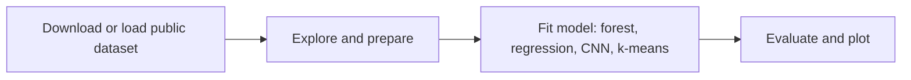

# Machine Learning Course Notebooks: teaching notebooks from linear regression to CNNs

[](https://creativecommons.org/licenses/by-nc-nd/4.0/) [](#notebooks)

## Overview

Thirteen Jupyter notebooks that walk through classic machine-learning topics: random forests and decision trees, regression on the California housing data, neural networks in TensorFlow and PyTorch, a CNN on MNIST, k-means with silhouette analysis, text classification and pandas basics. Most notebooks keep the outputs they produced, so students can read them without running anything. Six were re-run on 2026-10-13 and 2026-10-14 (four of them fixed to download their own data), including the CNN on MNIST.

## Demo

No hosted demo. Open any notebook in Google Colab with the badges in the [Notebooks table](#notebooks).

## Problem statement

Students learning ML need small, runnable examples on public data, each showing one idea end to end. These notebooks are that material. Before this update most of them could not run from a clean copy: they read data from Colab or Kaggle paths that were not in the repository, and two broke on current library versions.

## Approach

Each notebook is self-contained and follows the usual flow: load data, explore it, fit a model, evaluate it. The notebooks that were re-run fetch their data in their first cells (a download from the dataset's public source, or a Keras loader), so they work in a clean checkout and in Colab.



## Data

No data is stored in this repository. Public datasets are downloaded by the notebooks into a git-ignored `data/` folder; the sources and licenses are listed in [THIRD_PARTY_NOTICES.md](THIRD_PARTY_NOTICES.md).

| Dataset | Rows | Source | License / terms |
|---|---|---|---|
| Banknote Authentication (Lohweg, 2012) | 1,372 | UCI Machine Learning Repository | CC BY 4.0 |
| California housing (training set) | 17,000 | Google Machine Learning Crash Course | Per the course page |
| MNIST | 60,000 train / 10,000 test | Keras loader | Per the MNIST authors |

Other notebooks use Kaggle competition data (Titanic, Disaster Tweets), a Pima diabetes file, `world_alcohol.csv` and `tip-amount.xlsx`. These are not in the repository, and the source of the last two is not yet confirmed.

## Notebooks

| Notebook | Topic | Dataset | Outputs (cells with output / code cells) | Open in Colab | Status |
|---|---|---|---|---|---|
| `ANN_using_pytorch.ipynb` | Feed-forward neural network in PyTorch (banknote forgery detection) | Banknote Authentication (UCI), downloaded by the notebook | yes (14/23) | [](https://colab.research.google.com/github/Janeferdinant/Machine-learning-Course/blob/master/ANN_using_pytorch.ipynb) | Not re-run (needs PyTorch, which is not in requirements.txt). Data cell updated |
| `ANN_using_tensorflow.ipynb` | Neural network in TensorFlow/Keras, with a network diagram | Banknote Authentication (UCI), downloaded by the notebook | yes (52/78) | [](https://colab.research.google.com/github/Janeferdinant/Machine-learning-Course/blob/master/ANN_using_tensorflow.ipynb) | Not re-run (needs ann_visualizer and graphviz; a later cell reuses stale variables). Data cell updated |
| `CNN_Identify_the_Digits_(MNIST).ipynb` | CNN digit classifier | MNIST (Keras loader); the optional personal-image cells (2.jpeg) are skipped when the file is missing | yes (35/41), no errors | [](https://colab.research.google.com/github/Janeferdinant/Machine-learning-Course/blob/master/CNN_Identify_the_Digits_%28MNIST%29.ipynb) | Verified (re-run 2026-10-14, full settings: batch size 10, 5 epochs, CPU, 12 min): test accuracy 0.9905. Three cells adjusted so it runs outside Colab |
| `Natural_Language_Processing_with_Disaster_Tweets.ipynb` | Text preprocessing, word2vec and Naive Bayes on tweets | Kaggle "Disaster Tweets" competition data (login; not in repo) | yes (45/57) | [](https://colab.research.google.com/github/Janeferdinant/Machine-learning-Course/blob/master/Natural_Language_Processing_with_Disaster_Tweets.ipynb) | Not re-run (Kaggle data; uses the gensim 3 API) |
| `SigmoidNeuron.ipynb` | Sigmoid neuron from scratch | Synthetic, generated in the notebook | yes (13/26) | [](https://colab.research.google.com/github/Janeferdinant/Machine-learning-Course/blob/master/SigmoidNeuron.ipynb) | Verified (re-run 2026-10-14, 56 s): runs clean after replacing `tqdm_notebook` with `tqdm` |
| `banknote_randomforest.ipynb` | Random forest vs decision tree on banknote data | Banknote Authentication (UCI), downloaded by the notebook | yes (3/11) | [](https://colab.research.google.com/github/Janeferdinant/Machine-learning-Course/blob/master/banknote_randomforest.ipynb) | Verified (re-run 2026-10-13, 35 s): runs clean. Data is downloaded in code |
| `california_regression.ipynb` | Linear regression in TensorFlow, then a random forest | California housing (Google MLCC), downloaded by the notebook | yes (17/27) | [](https://colab.research.google.com/github/Janeferdinant/Machine-learning-Course/blob/master/california_regression.ipynb) | Verified (re-run 2026-10-13, 5 min): runs clean after fixing a plot error on current NumPy |
| `diabetes.ipynb` | Decision tree on diabetes data, graphviz export | Pima Indians Diabetes diabetes.csv (not in repo) | yes (10/19) | [](https://colab.research.google.com/github/Janeferdinant/Machine-learning-Course/blob/master/diabetes.ipynb) | Not re-run (data not in repo; imports a module removed from scikit-learn) |
| `mnist_opencv.ipynb` | Small CNN on MNIST | MNIST (Keras loader) | yes (14/20) | [](https://colab.research.google.com/github/Janeferdinant/Machine-learning-Course/blob/master/mnist_opencv.ipynb) | Verified (re-run 2026-10-13, 3 min): runs clean after fixing a removed Keras method |
| `plot_kmeans_silhouette_analysis.ipynb` | K-means and silhouette analysis | Synthetic, make_blobs | yes (1/2) | [](https://colab.research.google.com/github/Janeferdinant/Machine-learning-Course/blob/master/plot_kmeans_silhouette_analysis.ipynb) | Executed 2026-10-13 (11 s). It had no outputs before |
| `tip_amount_tensorflow.ipynb` | Linear regression in TensorFlow | tip-amount.xlsx (not in repo; source unknown) | yes (8/13), committed error | [](https://colab.research.google.com/github/Janeferdinant/Machine-learning-Course/blob/master/tip_amount_tensorflow.ipynb) | Not re-run (data not in repo). Has a committed error |
| `titanic-tutorial.ipynb` | Titanic survival: feature engineering and models | Kaggle Titanic data (login; not in repo) | yes (32/43) | [](https://colab.research.google.com/github/Janeferdinant/Machine-learning-Course/blob/master/titanic-tutorial.ipynb) | Not re-run (Kaggle data) |
| `world_alcohol_pandas_revision.ipynb` | pandas selection and filtering | world_alcohol.csv (not in repo) | yes (30/31) | [](https://colab.research.google.com/github/Janeferdinant/Machine-learning-Course/blob/master/world_alcohol_pandas_revision.ipynb) | Not re-run (data not in repo) |

Status labels: **Verified (re-run date)** means the notebook was executed top to bottom and its outputs were kept. **Not re-run (reason)** means it was only edited as described, or not touched, and its stored outputs come from earlier sessions. The Colab links use the `master` branch, which is this repository's default branch.

## Results

Numbers come from the re-runs on 2026-10-13 (log: [docs/runs/2026-10-13-notebook-reruns.md](docs/runs/2026-10-13-notebook-reruns.md)) and 2026-10-14 (log: [docs/runs/2026-10-14-cnn-mnist.md](docs/runs/2026-10-14-cnn-mnist.md)). None of the notebooks sets a random seed, so repeated runs differ slightly.

| Metric | Value | Status | How measured | Date |
|---|---|---|---|---|
| Banknote, random forest accuracy | 0.99125 (0.9912536443148688) | Verified (re-run 2026-10-13) | `banknote_randomforest.ipynb`, 343 held-out rows, confusion matrix [[184, 3], [0, 156]] | 2026-10-13 |
| California housing, random forest R² | 0.8094 (0.8094088629585355), MSE 2616.38 | Verified (re-run 2026-10-13) | `california_regression.ipynb`, as printed by the notebook | 2026-10-13 |
| MNIST, small CNN, 1 epoch at batch size 1 | training accuracy 0.8985 | Verified (re-run 2026-10-13) | `mnist_opencv.ipynb`. Training accuracy, not a test score | 2026-10-13 |
| MNIST, CNN (2 conv + dense), 5 epochs at batch size 10, full 60,000 training images | test accuracy 0.9905 (0.9904999732971191), test loss 0.0297 | Verified (re-run 2026-10-14, full settings, CPU) | `CNN_Identify_the_Digits_(MNIST).ipynb`, 10,000 MNIST test images (also used as the validation set; no tuning was done on it). Log: [docs/runs/2026-10-14-cnn-mnist.md](docs/runs/2026-10-14-cnn-mnist.md) | 2026-10-14 |
| Metrics printed in the other notebooks | as stored in each notebook | Not re-run (see the Notebooks table for reasons) | Notebook outputs | before 2026-10-13 |

## Tech stack

Python 3.11, Jupyter, TensorFlow 2.15.1 with Keras 2.15.0, scikit-learn 1.5.2, NumPy 1.26.4, pandas 2.2.3, matplotlib 3.9.2, seaborn 0.13.2. `ANN_using_pytorch.ipynb` also uses PyTorch, which is not pinned because that notebook was not re-run.

## Getting started

Prerequisites: Python 3.11 (TensorFlow 2.15 supports 3.9 to 3.11), about 2 GB of disk space for the packages, and an internet connection for the dataset downloads. The commands below were tested on Windows; on Linux or macOS use `python3.11 -m venv .venv` and `source .venv/bin/activate` instead of the two Windows lines.

```bash
git clone https://github.com/Janeferdinant/Machine-learning-Course.git
cd Machine-learning-Course
py -3.11 -m venv .venv
.venv\Scripts\activate
pip install -r requirements.txt
python -m jupyter nbconvert --to notebook --execute --output-dir run-output banknote_randomforest.ipynb
```

Expected: the last command writes `run-output/banknote_randomforest.ipynb` in well under a minute, and the cell that prints the random forest accuracy shows `0.9912536443148688`. To work interactively, install JupyterLab (`pip install jupyterlab`), run `python -m jupyter lab` and open any notebook. TensorFlow is a large install and can take a long time on a slow connection.

## Project structure

```
*.ipynb                    The 13 notebooks
requirements.txt           Package versions used for the 2026-10-13 re-runs
docs/runs/                 Logs of the re-runs
finance.py                 A Colab export of a Streamlit stock demo; not valid Python (see Limitations)
THIRD_PARTY_NOTICES.md     Dataset and code credits and licenses
LICENSE                    CC BY-NC-ND 4.0
data/                      Created by the notebooks; git-ignored
```

## Real-world applications

Fraud and forgery detection (banknotes), property price estimation (California housing), digit and image recognition (MNIST), segmentation (k-means), and text classification (tweets).

## Limitations

- Six notebooks were re-run (four on 2026-10-13, `CNN_Identify_the_Digits_(MNIST)` and `SigmoidNeuron` on 2026-10-14). The rest keep their old outputs, and some will not run as they are: they need data that is not in the repository (Kaggle, a Pima diabetes file, `world_alcohol.csv`, `tip-amount.xlsx`) or older library versions (`diabetes` imports a module that no longer exists in scikit-learn; the NLP notebook uses the gensim 3 API).
- `CNN_Identify_the_Digits_(MNIST)` was re-run on 2026-10-14 with its original training settings (30,000 training steps, about 10 minutes of training on an 8-core CPU). The network diagram cell needs Graphviz and prints a note without it, and the personal-image cells (`2.jpeg`) are skipped because that file is not in the repository.
- `tip_amount_tensorflow` has a stored error (it uses variables that are never defined). `ANN_using_tensorflow` has a later cell that reuses the wrong predictions.
- Results vary between runs because no seeds are set. The `mnist_opencv` accuracy of 0.8985 is a training accuracy, not a test score; the CNN notebook's 0.9905 is measured on the 10,000 test images.
- `mnist_opencv` is named after OpenCV but does not use it.
- The versions in `requirements.txt` were tested locally, not in Colab. Colab ships newer TensorFlow, Keras and NumPy, so a notebook may behave differently there.
- `finance.py` contains `!pip install` lines, so it cannot run as a Python file; it is left as uploaded.
- The sources of `tip-amount.xlsx` and `world_alcohol.csv` are not confirmed, so those two notebooks may not be redistributable.

## Future scope

Fix and re-run the remaining notebooks, set random seeds, add a Colab smoke test for the self-contained notebooks, and map notebooks to lecture topics.

## Credits & citation

- **Origin.** This repository was created from the GitHub Learning Lab course "Get Started with TensorFlow" (everydeveloper) under the name `TensorFlow-Pokemon-Course`, and later renamed. No course content remains. See [THIRD_PARTY_NOTICES.md](THIRD_PARTY_NOTICES.md).
- **Code.** `plot_kmeans_silhouette_analysis` follows the scikit-learn example gallery (BSD-3-Clause). `california_regression` and `tip_amount_tensorflow` build on Google's Machine Learning Crash Course exercise "Linear regression with a real dataset" (Apache-2.0). Others follow public tutorials, listed with their confidence level in THIRD_PARTY_NOTICES.md.
- **Data.** Lohweg, V. (2012). Banknote Authentication [Dataset]. UCI Machine Learning Repository. https://doi.org/10.24432/C55P57. California housing data via Google's Machine Learning Crash Course. MNIST by LeCun, Cortes and Burges. Kaggle competition data (Titanic, Disaster Tweets) under the competitions' rules.

## License

Original work © Jane Rose Ferdinant, licensed CC BY-NC-ND 4.0. Third-party components retain their own licenses; see THIRD_PARTY_NOTICES.md.

## Author

Jane Rose Ferdinant: [Portfolio](https://janeferdinant.vercel.app) · [LinkedIn](https://www.linkedin.com/in/janerosenf/)
